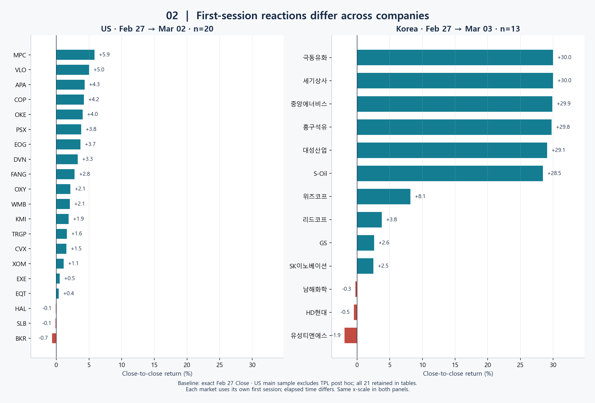
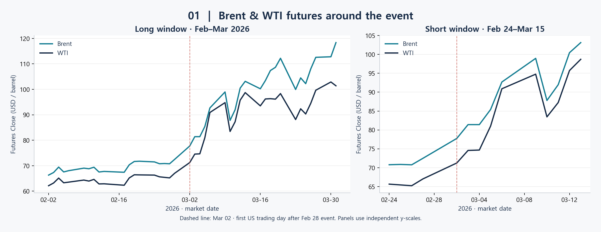
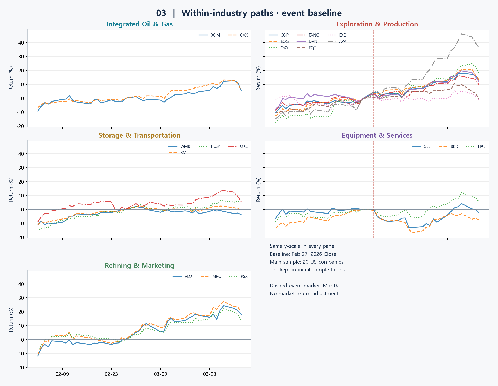
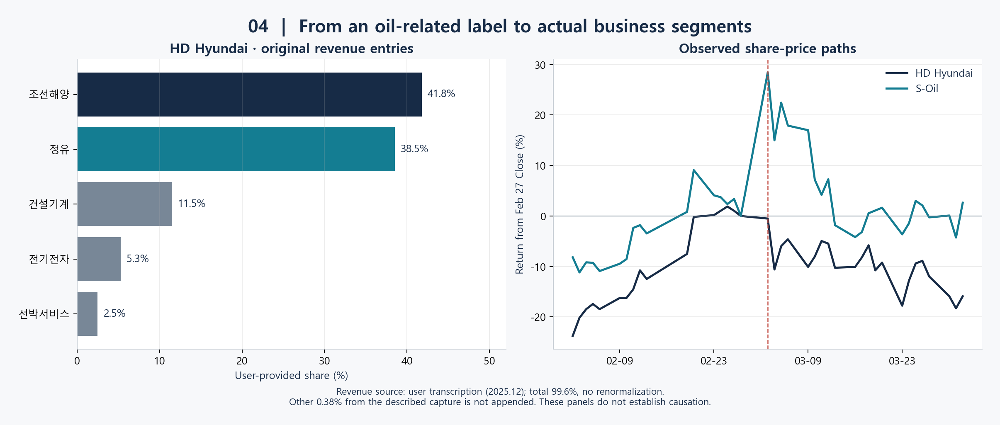

# War & Oil Stock Price

**미국–이란 전쟁 전후, 한국과 미국의 석유 관련 기업 주가와 사업 구조를 탐색했습니다.**

“전쟁 이후 석유 관련 주식은 모두 비슷하게 올랐을까?”라는 질문에서 출발했습니다. 국가별·기업별 주가를 비교하고, 예상과 다른 움직임을 보인 기업의 매출 구성을 조사하면서 **같은 석유 관련 기업이라도 실제 사업 구조는 다를 수 있다는 점**에 주목했습니다.

## 1 : 질문 배경 / 문제 정의

### 질문의 출발점

2026년 2월 28일 전쟁 발발 이후, 한국 증시의 하락으로 손실을 본 투자자들의 이야기와 함께 “석유 관련 종목은 오히려 올랐으니 해당 투자자들은 수익을 얻었을 것”이라는 이야기를 접했습니다. 중동 지역의 혼란이 유가와 석유 기업의 주가를 끌어올릴 것이라는 직관적인 기대에서 분석을 시작했습니다.

그러나 실제 데이터를 살펴보니 같은 석유 관련 기업으로 분류되더라도 주가 반응은 국가별·기업별로 다르게 나타났습니다. 처음에는 **엑슨모빌과 S-Oil의 반응 차이**에 주목했고, 이후 분석 대상을 미국과 한국의 여러 석유 관련 기업으로 확대했습니다.

미국에서는 일부 세부 업종 내 기업들이 비교적 유사한 흐름을 보인 반면, 한국에서는 석유 관련 기업으로 함께 묶인 종목 사이에서도 서로 다른 움직임을 관찰했습니다. 이러한 차이를 단순히 “한국 시장은 원래 이상하다”는 설명으로 끝내기보다, **데이터에서 확인할 수 있는 패턴과 기업별 차이가 있을 것**이라는 생각으로 탐색했습니다.

### 분석 목적

| 목적 | 분석에서 다룬 내용 |
|---|---|
| 현상에 대한 기술·요약 | 전쟁 전후 유가와 분석 대상 기업의 주가가 어떻게 변화했는지 정리했습니다. |
| 탐색 | 국가별·기업별 차이와 세부 업종별 주가 흐름을 비교했습니다. |
| 관계 설명을 위한 탐색 | 매출 구성과 사업 다각화가 주가 반응의 차이를 이해하는 데 어떤 단서를 주는지 살펴봤습니다. |

### 핵심 질문

> **미국–이란 전쟁 이후 한국과 미국의 석유 관련 기업 주가는 어떻게 다르게 반응했으며, 이러한 차이는 기업의 사업 구조와 어떤 관련이 있는가?**

다음 세부 질문을 중심으로 분석했습니다.

- **유가의 변화:** 전쟁 전후 Brent·WTI 원유 선물 가격은 어떤 흐름을 보였는가?
- **주가 반응의 차이:** 한국과 미국의 분석 대상 기업들은 상승·하락 폭과 시간에 따른 움직임에서 어떤 차이를 보였는가? 같은 세부 업종의 기업들은 유사하게 움직였는가?
- **사업 구조와의 관계:** 석유·가스 관련 매출과 비에너지 사업의 구성은 기업별 주가 반응 차이와 어떤 관련을 보였는가?

초기에는 국가별·기업별 주가 반응의 차이를 파악하는 데 집중했습니다. 분석 과정에서 매출 구성을 설명 후보로 발견하면서 사업 구조와의 관계로 질문을 확장했습니다. 기업 규모와 사업 지역도 설명 후보로 고려했지만, 이를 별도 변수로 검증하는 단계까지는 진행하지 않았습니다.

### 이 질문이 중요한 이유

같은 업종이나 투자 테마로 묶인 기업이라도 실제 매출을 창출하는 사업은 다를 수 있다는 점에 주목했습니다. 업종 이름만 보고 기업을 판단할 때 놓칠 수 있는 차이를 살펴보고, 하나의 사건에 대한 기업별 반응을 더 구체적으로 이해하고자 했습니다.

이 프로젝트에서는 주가 데이터와 사업 구성 자료를 함께 살펴보면서, **기업 분류와 함께 실제 매출 구성과 사업 구조를 확인할 필요성**을 탐색적으로 제안했습니다.

## 2 : 데이터 수집과 분석 대상 설정

### 분석 기간

전쟁 발발 전후의 흐름과 사건 직후의 반응을 구분해 비교했습니다. 사건 기준일은 **2026년 2월 28일**로 설정했습니다.

| 분석 범위 | 설정한 기간·비교일 |
|---|---|
| 장기 유가 탐색 | 2026년 2월 1일~3월 31일 |
| 단기 유가 탐색 | 2026년 2월 24일~3월 15일 |
| 일별 주가 확장 분석 | 2026년 2월 1일~4월 1일 |
| 미국의 사건 직후 반응 | 2월 27일 종가 대비 3월 2일 종가 |
| 한국의 사건 직후 반응 | 2월 27일 종가 대비 3월 3일 종가 |

단기 유가 코드의 `end="2026-03-16"`은 종료일을 포함하지 않으므로, 요청 범위를 3월 15일까지로 정리했습니다. 각 범위에서 실제 거래일의 관측값을 사용했으며, 실제 첫·마지막 관측일은 [수집 기록](data/processed/acquisition_manifest.csv)에 기록했습니다. 한국은 3월 2일 휴장으로 첫 비교일을 3월 3일로 설정했습니다.

### 기업 선정

| 국가 | 선정 과정과 분석 표본 |
|---|---|
| 미국 | S&P 500 에너지 섹터에서 출발해 초기 21개 기업을 살펴봤습니다. 이후 TPL을 주 비교에서 제외해 20개 기업을 비교했습니다. 매출 구성 자료는 별도로 확보한 18개 기업을 사용했습니다. |
| 한국 | 초기에는 KOSPI 기업명 키워드 검색으로 후보를 탐색했고, 이후 토스증권의 석유 관련 업종 분류에서 검색한 기업들을 조사했습니다. 제공된 최종 목록 13개 기업을 분석했으며, KOSPI 8개·KOSDAQ 5개로 구성했습니다. |

미국 분석에는 기존에 선정한 고정 목록을 사용했으며, 사건 당시의 S&P 500 구성종목 전체를 재구성하지는 않았습니다. 한국 역시 검색으로 확보한 목록을 분석했으며, 석유 관련 기업 전체를 빠짐없이 포함했는지는 별도로 검증하지 않았습니다.

### 데이터 출처

| 데이터 | 출처·수집 방법 |
|---|---|
| 기업별 주가 | Yahoo Finance · Python `yfinance` |
| Brent·WTI 원유 선물 가격 | Yahoo Finance · `yfinance`의 `BZ=F`, `CL=F` |
| 기업별 사업 구성과 매출 비중 | FnGuide 및 기업 IR 기반의 증권 앱 자료를 확인하고 입력했습니다. |
| 초기 기업 후보·분류 | Wikipedia의 S&P 500 목록, FinanceDataReader의 KRX 목록, 토스증권 업종 분류를 활용했습니다. |

사건 날짜는 [Reuters 보도](https://au.investing.com/news/israel-and-us-launch-strikes-on-iran-targeting-its-leadership-4285236?ampMode=1), 한국 휴장일은 [삼일절 대체휴일 관련 자료](https://www.samsungpop.com/common.do?cmd=down&contentType=application%2Fpdf&fileName=4010%2F2026022717364620K_02_01.pdf&inlineYn=Y&saveKey=research.pdf)와 대조했습니다. 상세 출처는 [출처 문서](docs/sources.md)에 정리했습니다.

## 3 : 데이터 전처리

- **날짜 정렬:** 날짜 형식을 통일하고 실제 거래일만 추출했습니다. 국가별 휴장일을 고려해 미국과 한국의 사건 후 첫 거래일을 각각 비교했습니다.
- **결측치 처리:** Brent·WTI 종가를 날짜 기준으로 결합하고, 둘 중 하나라도 값이 없는 행은 제외했습니다.
- **비교용 변수 생성:** 기업별 주가 수준의 차이를 고려해 기준일 대비 주가 변동률(%)로 변환했습니다.
- **기업 분류 검토:** 기존 산업 분류와 실제 매출 구성을 대조했습니다. HD현대와 TPL처럼 같은 그룹의 다른 기업과 사업 구조가 다른 사례를 발견했습니다.
- **표본 구분:** TPL은 직접 생산·정제 기업과 사업 모델의 비교 가능성이 다르다고 판단해 EDA 이후 주 비교에서 제외했습니다. 초기 목록과 상세 자료에는 남겨 제외 전후를 추적할 수 있도록 했습니다.

TPL은 [공식 사업보고서](https://www.sec.gov/Archives/edgar/data/1811074/000181107426000018/tpl-20251231.htm)의 토지·석유 및 가스 로열티·물 관련 사업을 참고했습니다. 석유와 무관한 기업으로 보지는 않았으며, 주가가 다르게 움직였다는 사실만으로 제외하지는 않았습니다.

매출 자료에서는 S-Oil의 제공 항목 합계가 80.1%이고, GS에 음수 항목이 있으며, 일부 미국 기업은 합계가 100%를 초과하는 점을 확인했습니다. 원래 입력을 보존하고, 누락분을 임의로 채우거나 합계를 100%로 정규화하지 않았습니다. 상세 내용은 [데이터 품질 보고서](reports/data_quality.md)에 정리했습니다.

## 4 : EDA와 가설 형성

### 초기 관찰 — 엑슨모빌과 S-Oil

전쟁 직후 두 기업의 주가 반응 차이가 분석의 계기가 되었습니다. 이후 미국과 한국의 여러 기업으로 대상을 넓혀, 이 차이가 다른 기업에서도 나타나는지 탐색했습니다.



### 패턴 탐색 — 유가와 세부 업종별 주가 흐름

Brent·WTI의 사건 전후 추이를 살펴보고, 기업별 주가를 기준일 대비 변동률로 시각화했습니다. 미국에서는 통합 석유·가스와 정제·판매 업종에서 비교적 유사한 흐름을 관찰했습니다. 탐사·생산과 저장·운송에서는 개별 기업의 차이도 확인했습니다.





### 예상 밖 사례 — HD현대가 바꾼 분석 관점

석유 관련 기업으로 분류해 살펴보던 HD현대가 예상과 다른 주가 흐름을 보여, 실제 매출 구성을 조사했습니다. 당시 한화오션의 하락에도 주목하고 있었기 때문에 조선해양 사업의 비중을 눈여겨봤습니다.

HD현대의 제공 매출 자료에서는 **조선해양이 41.8%, 정유가 38.5%**를 차지했습니다. 석유 관련 기업으로 묶여 있었지만 가장 큰 매출 항목은 조선해양이라는 점을 확인했습니다.

이 사례를 계기로 산업 분류만으로는 드러나지 않는 사업 구조에 주목했습니다. 다른 기업의 매출 구성도 조사했고, 그 과정에서 TPL의 사업 모델을 별도로 검토했습니다.



### 가설 형성

> **전쟁 이후 기업별 주가 반응은 산업 분류뿐 아니라 석유 관련 매출 비중, 사업 다각화 정도, 사업 지역에 따라 달라질 수 있다**는 가설을 세웠습니다.

이 가설을 바탕으로 실제 사업 구성을 살펴봤으며, 각 요인의 독립적인 효과를 검증한 것으로 해석하지는 않았습니다.

## 5 : 분석 설계 및 비교 방법

국가별 첫 거래일을 기준으로 사건 직후 반응을 비교하고, 더 긴 기간의 일별 흐름을 함께 살펴봤습니다. 가격 수준이 다른 기업을 비교하기 위해 다음과 같이 기준일 대비 변동률을 계산했습니다.

```text
기준일 대비 변동률(%) = (관측일 종가 / 기준일 종가 - 1) × 100
```

사건 반응 비교에서는 2월 27일을 기준으로 사용했습니다. 기존 장기 탐색 코드에서는 수집 범위의 첫 관측일을 기준으로 사용했으므로, 분석별 기준일을 구분했습니다.

세부 업종별 주가 흐름을 비교한 뒤, 예상과 다른 기업의 매출 구성을 살펴보는 방식으로 분석했습니다. 별도의 머신러닝 모델은 학습하지 않았습니다.

## 6 : 평가와 검증

그래프와 주가 변동률을 통해 패턴을 탐색했습니다. 통계적 가설검정이나 다른 전쟁 사례를 통한 재검증은 수행하지 않았으며, 관찰한 패턴과 후속 검증이 필요한 해석을 구분했습니다.

재현 과정에서는 날짜·기준일·결측 처리와 수익률 계산에 대한 코드 검증을 수행했습니다. 이러한 구현 검증을 사업 구조와 주가의 관계에 대한 통계적 검증으로 해석하지는 않았습니다.

## 7 : 핵심 발견과 해석

재현 분석에서 사건 직후 첫 거래일의 결과를 다음과 같이 정리했습니다.

| 분석 대상 | 2월 27일 종가 대비 첫 거래일 결과 |
|---|---|
| 미국 주 비교 표본 20개 | 상승 17개 · 하락 3개 |
| 한국 주 비교 표본 13개 | 상승 10개 · 하락 3개 |
| 엑슨모빌 | +1.13% |
| S-Oil | +28.45% |
| HD현대 | -0.51% |

미국 장비·서비스 기업인 SLB·BKR·HAL은 첫 거래일에 모두 소폭 하락했습니다. 이를 통해 **석유 관련 기업이라는 이유만으로 사건 직후 모두 상승하거나 같은 폭으로 반응하지는 않았다**는 점을 확인했습니다.

특히 HD현대의 사례에서 업종 이름과 실제 매출 구성의 차이를 발견했습니다. 정유 사업과 함께 조선해양 등 다른 사업을 보유한 기업을 이해하려면, 기존 산업 분류에 더해 실제 사업 구성을 살펴볼 필요가 있다고 해석했습니다.

다만 매출 구성이 주가 차이의 원인임을 입증하거나, 모든 기업에서 동일한 관계가 성립한다고 결론 내리지는 않았습니다. 위 수치는 분석 표본의 종가 변화로 해석했으며, 국가 전체 증시의 수익률이나 전쟁의 인과 효과로 해석하지 않았습니다.

## 8 : 한계와 후속 과제

- **단일 사건과 제한된 표본:** 한 차례의 전쟁과 선정한 기업을 분석했으므로, 다른 전쟁이나 기업에도 적용되는지는 검증하지 못했습니다.
- **시장·기업 요인 미통제:** 시장 전체의 움직임과 기업별 규모·개별 뉴스·사업 지역 등의 영향을 분리하지 못했습니다. 국가별 첫 거래일까지의 경과 시간도 달랐습니다.
- **매출 자료의 비교 가능성:** 사업부문 정의와 세분화 수준이 달랐으며, 일부 자료에는 누락과 합계 불일치가 있었습니다. 따라서 정확한 석유 비중이나 다각화 지수를 일괄 산출하지 않았습니다.
- **탐색 이후 형성한 가설:** 데이터를 본 뒤 가설을 만들고 TPL을 주 비교에서 제외했으므로, 해당 표본에서 발견한 패턴을 독립적인 검증 결과로 간주하지 않았습니다.
- **후속 분석:** 시장 대비 초과수익률 분석, 비교 가능한 매출 변수 정비, 다른 사건·기간에서의 재검증을 후속 과제로 제안했습니다. 이를 바탕으로 회귀분석 등 통계적 방법을 적용해 관계의 크기와 불확실성을 평가하는 방향을 제안했습니다.

## 코드 실행 및 상세 자료

프로젝트 루트의 PowerShell에서 실행할 수 있도록 구성했습니다.

```powershell
python -m venv .venv
.\.venv\Scripts\python -m pip install -r requirements.txt
.\.venv\Scripts\python scripts/run_analysis.py
.\.venv\Scripts\python -m pytest -q
```

기존 캐시를 우선 사용하도록 구성했습니다. `--refresh`로 재수집하고, `--offline`으로 캐시만 사용하도록 설정했습니다. 수집 시각·버전·요청 기간과 실제 관측 범위는 [수집 기록](data/processed/acquisition_manifest.csv)에 기록했습니다.

[분석 보고서](reports/analysis.md) · [데이터 품질 보고서](reports/data_quality.md) · [분석 노트북](notebooks/01_exploration.ipynb) · [데이터 출처](docs/sources.md) · [재현 방법](docs/reproduction.md) · [표본 선정·제외 기록](data/reference/sample_decisions.csv)
