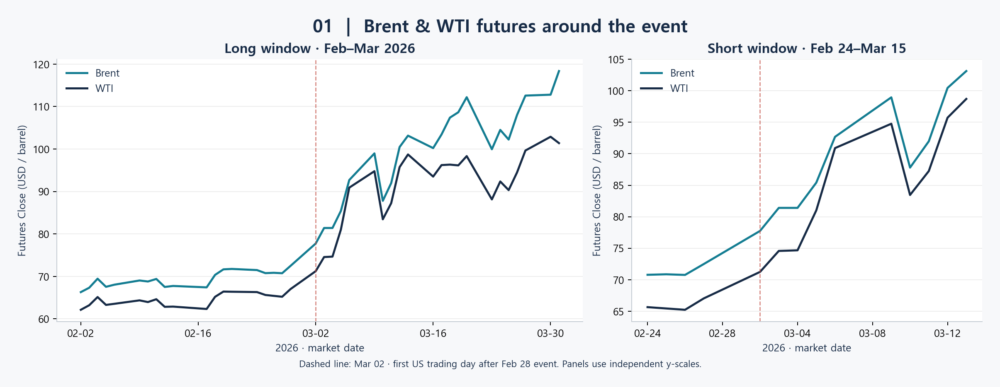
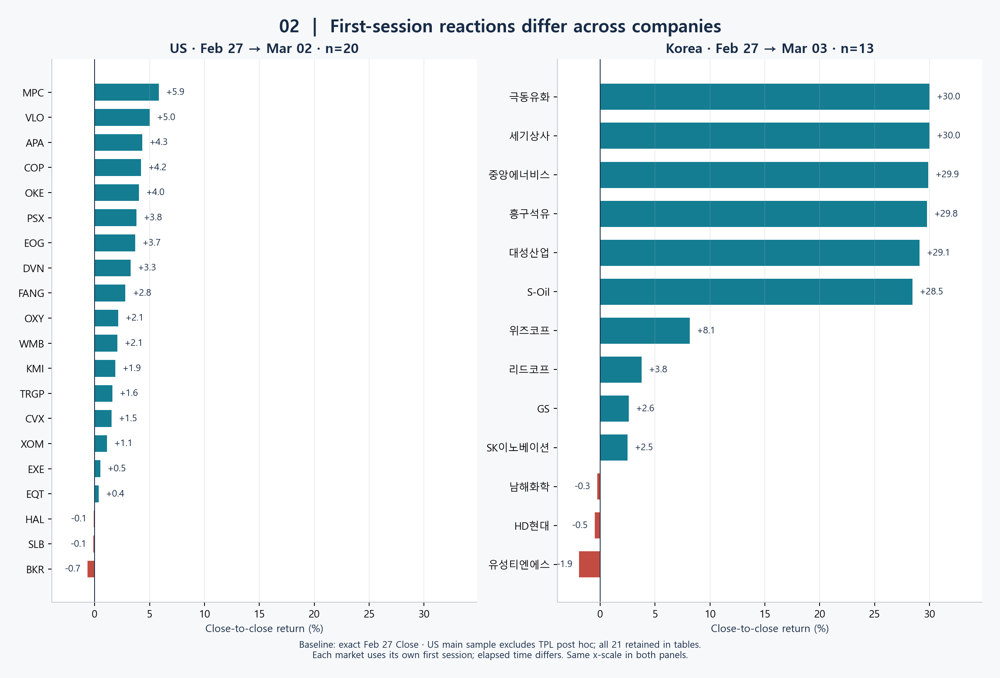
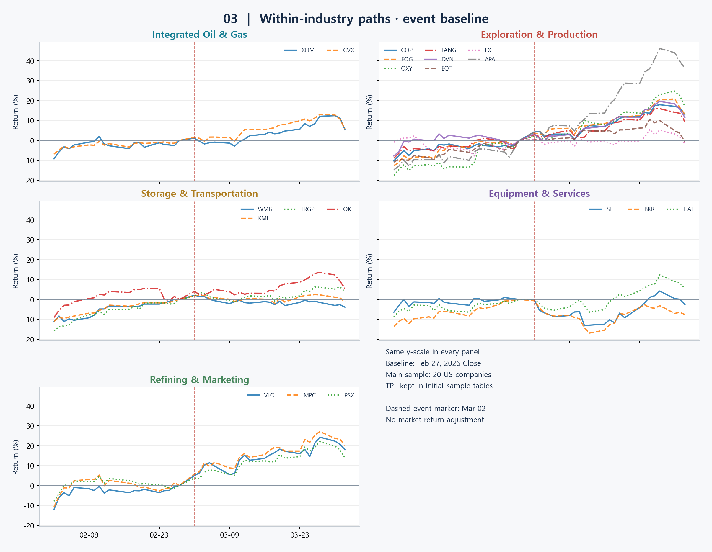
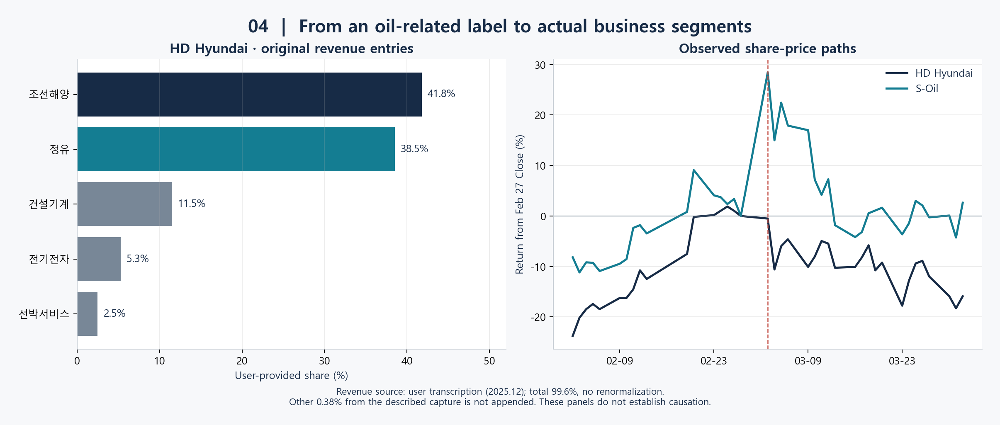
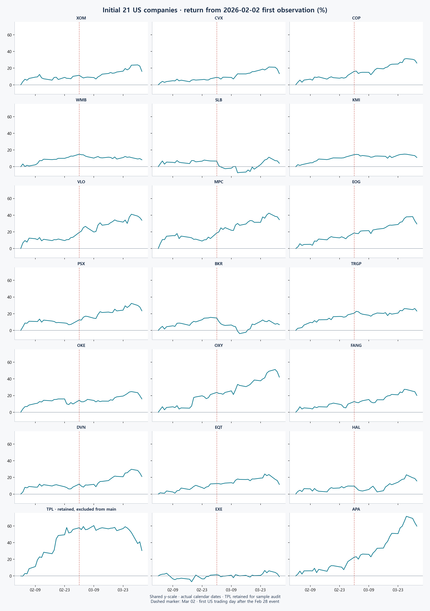
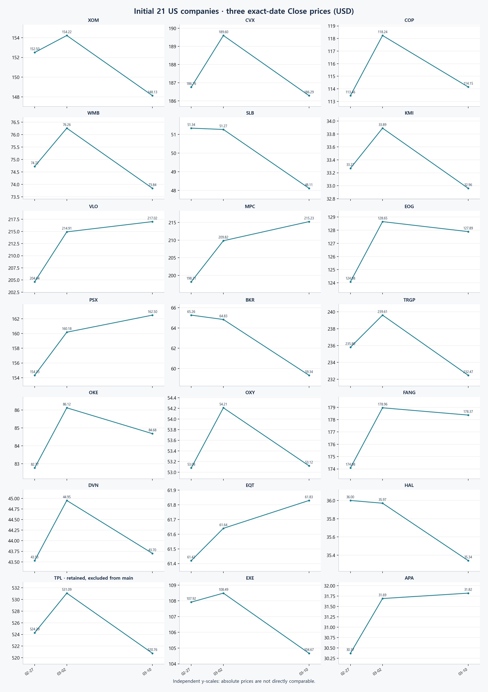

# 분석 보고서

## 1. 문제 정의와 질문 발전

“전쟁 이후 석유 관련 기업의 주가가 오를 것”이라는 기대를 출발점으로 정리했습니다. 수요 급증이나 주가 상승의 인과관계가 확인된 명제로 사용하지 않았습니다. 엑슨모빌·S-Oil에서 국가·세부 업종 비교로 확장한 뒤 HD현대·TPL 사례를 통해 사업 구성의 설명 가능성을 살펴보는 흐름을 재구성했습니다. 과거 탐색 순서는 사용자 설명으로, 아래 수치는 이번 재수집으로 구분했습니다.

## 2. 수집·기간·표본 선정

사건일은 2/28로 설정하고 [Reuters](https://au.investing.com/news/israel-and-us-launch-strikes-on-iran-targeting-its-leadership-4285236?ampMode=1)의 미국·이스라엘 공격 개시 보도와 대조했습니다. 3/2 한국 휴장은 [삼성증권 일정](https://www.samsungpop.com/common.do?cmd=down&contentType=application%2Fpdf&fileName=4010%2F2026022717364620K_02_01.pdf&inlineYn=Y&saveKey=research.pdf)으로 확인했으며 KRX 원문 웹 열람은 403으로 제한됐습니다. 미국 3/2·한국 3/3의 정확한 종가를 비교했습니다.

미국 초기 고정 21개, 주 비교 20개, 매출 입력 18개를 구별했습니다. COP·APA의 매출 자료 부재 이유는 미제공으로 남겼습니다. 한국은 초기 KOSPI 키워드 후보 수집과 후속 토스증권 검색 기반 제공 13개 목록을 구별했습니다. 전수조사나 임의 시총 컷오프를 전제하지 않았습니다. 현재 후보·시총 수집은 선택 스크립트로 분리하고 사건 당시 구성이나 규모 분석으로 사용하지 않았습니다.

| window | requested_start | end_exclusive | actual_first_date | actual_last_date | ticker_count |
| --- | --- | --- | --- | --- | --- |
| oil_long | 2026-02-01 | 2026-04-01 | 2026-02-02 | 2026-03-31 | 2 |
| oil_short | 2026-02-24 | 2026-03-16 | 2026-02-24 | 2026-03-13 | 2 |
| us_three_dates | 2026-02-25 | 2026-03-15 | 2026-02-25 | 2026-03-13 | 21 |
| us_daily | 2026-02-01 | 2026-04-02 | 2026-02-02 | 2026-04-01 | 21 |
| kr_daily | 2026-02-01 | 2026-04-02 | 2026-02-02 | 2026-04-01 | 13 |

위 표는 기업별 범위의 최소·최대 요약으로 작성했습니다. 세부 관측일·결측·실패 상태는 [수집 기록](../data/processed/acquisition_manifest.csv)에 기업별로 기록했습니다. 3/16은 단기 범위의 배타적 종료일로 처리했습니다.

## 3. 전처리와 새 품질 검증

시장 현지 날짜를 정규화하고 날짜 중복·비양수 종가를 검사했습니다. 유가는 Brent·WTI가 모두 있는 행만 유지하고 제외 행 수를 별도 표에 남겼습니다. 한국 휴장일을 미국 값으로 채우지 않았고 모든 결측은 그대로 유지했습니다. 기준일이 없는 기업에는 수익률 대신 결측 상태를 남겼습니다. 매출은 원문 항목과 수치를 보존하고 명시 항목·복합 항목·확인 필요를 구분했습니다. 이러한 코드·품질 검증은 이번 재현에 추가했으며 과거에 수행한 검증으로 서술하지 않았습니다.

## 4. EDA와 가설 형성

사용자는 HD현대의 하락과 변동을 보고 조선해양·정유 사업 구성을 조사했다고 설명했습니다. 제공값에서 조선해양 41.8%, 정유 38.5%를 확인했습니다. 한화오션에 대한 관심은 과거 문제의식의 맥락으로만 다루고 별도 비교 표본에 추가하지 않았습니다. HD현대 기타 0.38%는 미제공 캡처에 관한 사용자 전사 설명으로만 기록했으며 원 입력 99.6%에 추가하지 않았습니다.

TPL은 EDA 이후 사업 모델 비교 가능성을 기준으로 주 비교에서 제외했습니다. [2025 10-K](https://www.sec.gov/Archives/edgar/data/1811074/000181107426000018/tpl-20251231.htm)에서 토지·자원 관리 및 물 관련 사업, 에너지 로열티 수익원을 확인했습니다. 상이한 주가 흐름 자체를 제외 근거로 삼지 않았으며 지역·항로 원인은 검증하지 않았습니다. 사후 제외의 선택 편향을 한계에 포함했습니다.

## 5. 분석 설계와 피처 생성

변동률은 `(해당일 Close / 기준일 Close - 1) × 100`으로 계산했습니다. 주가는 `auto_adjust=False`의 Close로, 선물은 제공 코드와 같은 `True`로 고정했습니다. 주가 Close도 분할 조정 등 제공처 정책의 영향을 받을 수 있어 총수익률로 해석하지 않았습니다. 과거 주가 코드의 자동 조정 기본값과 버전이 미확정이므로 이전 결과와 완전히 동일하다고 주장하지 않았습니다.

일별 장기 분석은 각 시장 자료의 첫 관측 행을 공통 기준으로 삼았고, 사건 반응은 2/27을 별도 기준으로 사용했습니다. 실제 첫 관측일은 [기준일 표](../data/processed/daily_baselines.csv)에 기록했습니다. 별도 ML 모델과 다각화 지수를 만들지 않았습니다.

## 6. 평가와 검증

기준일·날짜·표본 매칭을 코드 수준에서 검증하고 그래프를 탐색적으로 비교했습니다. 테스트 통과는 공식과 결측 처리의 구현 검증으로 제한했습니다. 통계 가설검정·외부 사건 재검증·시장 대비 초과수익 분석은 수행하지 않았습니다. 산업 요약은 동일 기업 가중의 기술 통계로만 계산했습니다.

## 7. 실제 발견과 해석

US 주 비교 표본 20개 중 20개를 계산했고, 상승 17개·하락 3개·보합 0개를 확인했습니다. KR 주 비교 표본 13개 중 13개를 계산했고, 상승 10개·하락 3개·보합 0개를 확인했습니다.

| ticker | company | baseline_date | reaction_date | return_pct | status |
| --- | --- | --- | --- | --- | --- |
| XOM | ExxonMobil | 2026-02-27 | 2026-03-02 | 1.13 | ok |
| TPL | Texas Pacific Land Corporation | 2026-02-27 | 2026-03-02 | 1.30 | ok |
| 010950.KS | S-Oil | 2026-02-27 | 2026-03-03 | 28.45 | ok |
| 267250.KS | HD현대 | 2026-02-27 | 2026-03-03 | -0.51 | ok |

엑슨모빌 +1.13%, S-Oil +28.45%, HD현대 -0.51%를 이번 실행에서 확인했습니다. TPL의 초기 표본 반응 +1.30%도 보존했습니다. 첫 세션 결과만으로 이후 모든 거래일이나 모든 기업에서 초기 기대가 성립했다고 일반화하지 않았습니다. 사업 구성은 주가 차이를 이해하는 탐색적 단서로 제시했으며 업종보다 더 큰 영향력을 입증했다고 결론 내리지 않았습니다.

아래 표에서 선물의 2/27 대비 3/2 종가 변화를 계산했습니다. 장기·단기 경로에서 상승과 중간 반락을 함께 관찰했으며 지속적인 단조 상승으로 설명하지 않았습니다. 시계열은 연결 선물로 취급했고 개별 고정 월물의 보유 수익으로 해석하지 않았습니다.

| ticker | baseline_date | reaction_date | baseline_close | reaction_close | return_pct |
| --- | --- | --- | --- | --- | --- |
| BZ=F | 2026-02-27 | 2026-03-02 | 72.48 | 77.74 | 7.26 |
| CL=F | 2026-02-27 | 2026-03-02 | 67.02 | 71.23 | 6.28 |

세부 업종 그림에서는 동행과 이탈을 함께 비교하도록 동일한 y축을 적용했습니다. 분석 기간의 통합 석유·가스와 정제·판매에서는 유사한 흐름을 시각적으로 관찰했고, 탐사·생산과 저장·운송에서는 개별 기업의 차이도 확인했습니다. 장비·서비스는 SLB·BKR·HAL로 구분했고 첫 세션 변동률은 각각 -0.14%·-0.66%·-0.08%로 계산했습니다. 업종 라벨만으로 전체 기간의 경로 일치를 전제하지 않았으며 색 자체에 산업적 의미를 부여하지 않았습니다. 수치 요약은 [업종별 첫 세션 표](../data/processed/us_industry_first_session_summary.csv)로 제공했습니다.

사업 구성 그림은 회사별 원 비중을 사용했습니다. 기업별 pct/N을 합산하고 파이가 다시 정규화했던 이전 방식은 국가 전체 매출 비중으로 해석할 수 없어 대표 그림에서 사용하지 않았습니다. 불완전한 S-Oil과 합계 초과 미국 입력을 바탕으로 국가 간 석유 비중 또는 다각화 효과를 수치화하지 않았습니다.

## 8. 한계와 후속 과제

단일 사건·제한된 표본, 국가별 첫 거래일까지의 시간 차이, 시장·기업 특성 미통제, 매출 기준일·정의 차이와 누락을 한계로 기록했습니다. 사후 가설 형성과 TPL 제외에 따른 선택 편향을 인정하고 [제외 전후 표](../data/processed/tpl_sample_sensitivity.csv)를 함께 제공했습니다. 규모와 지역은 설명 후보였으나 현재 자료로 검증을 완료하지 않았습니다. 이후 시장 대비 초과수익률, 다른 사건과 기간, 사전 가설, 회귀 및 불확실성 검토를 후속 과제로 제안했습니다. 팀 구성과 개인 기여는 확인이 필요한 항목으로 남겼습니다.

## 부록: 초기 21개 보존

첫 관측일 기준 변동률에서는 모든 패널에 같은 y축을 적용했습니다. 세 시점 절대가격 그림에서는 회사별 y축 범위가 달라 직접적인 가격 수준 비교를 제한했습니다. 실제 날짜 간격을 반영했으며 3시점 사이의 선은 관측점 연결로만 사용했습니다.

